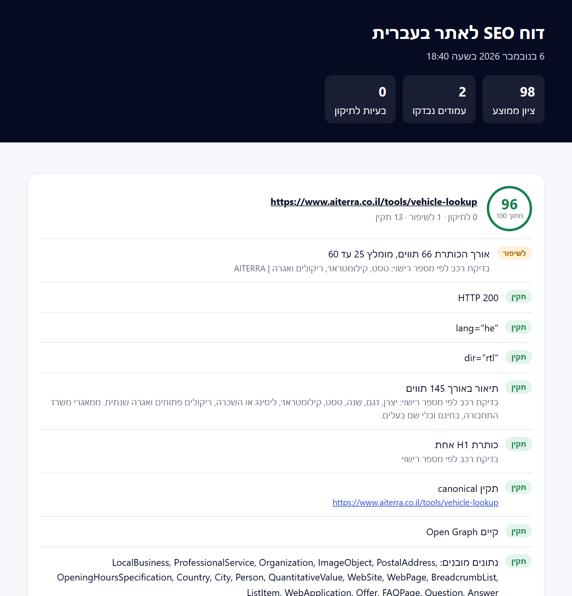

<div dir="rtl">

# hebrew-seo-audit · בדיקת SEO לאתרים בעברית

[](https://www.npmjs.com/package/hebrew-seo-audit)
[](LICENSE)


כלי שורת פקודה שבודק אתר ישראלי כמו שכלי SEO רגילים לא בודקים: כיווניות מימין לשמאל, כותרות ותיאורים בעברית, הצהרת נגישות שהחוק מחייב, ונראות במנועי AI כמו ChatGPT, Claude ו-Perplexity. בסוף הוא מוציא דוח HTML מעוצב בעברית.



## הפעלה

בלי התקנה:

```bash
npx hebrew-seo-audit www.example.co.il
```

או ישר מ-GitHub:

```bash
npx github:aiterra-il/hebrew-seo-audit www.example.co.il
```

כל האתר, לפי מפת האתר, עם דוח בעברית:

```bash
npx hebrew-seo-audit --sitemap https://www.example.co.il/sitemap.xml --limit 50 --html report.html
```

## מה נבדק

| בדיקה | למה זה חשוב |
|---|---|
| `lang="he"` ו-`dir="rtl"` | בלעדיהם קוראי מסך מקריאים עברית במבטא אנגלי, וטקסט מעורב עברית-אנגלית מתהפך |
| אורך הכותרת והתיאור | כותרת ארוכה מדי נחתכת בגוגל, ותיאור חסר מוחלף בטקסט אקראי מהעמוד |
| H1 אחד | הכותרת הראשית אומרת לגוגל על מה העמוד |
| canonical ו-hreflang | מונעים כפילויות בין גרסת העברית לגרסת האנגלית |
| JSON-LD | נתונים מובנים שגוגל ומנועי AI קוראים: עסק, שעות, שאלות נפוצות |
| Open Graph | בלעדיו קישור ששולחים בוואטסאפ מופיע בלי תמונה ובלי כותרת |
| alt לתמונות | נגישות, וגם חיפוש תמונות |
| **הצהרת נגישות** | תקנה 35ה לתקנות הנגישות מחייבת לפרסם אותה. הכלי מזהה גם תוספי נגישות נפוצים |
| **בוטים של AI ב-robots.txt** | אתר שחוסם את GPTBot, ClaudeBot או PerplexityBot לא יופיע בתשובות שלהם |
| llms.txt | קובץ שמסכם את האתר למנועי AI |
| noindex, viewport, HTTPS, Sitemap | הבסיס |

ה-robots.txt נקרא לפי הכללים של גוגל, כולל `*` ו-`$`, והכלל הארוך ביותר קובע.

## אפשרויות

| דגל | מה הוא עושה |
|---|---|
| `--sitemap <url>` | בודק את העמודים שבמפת האתר |
| `--limit <n>` | כמה עמודים לבדוק מהמפה (ברירת מחדל 20) |
| `--html <file>` | שומר דוח HTML בעברית |
| `--json` | מדפיס את התוצאות כ-JSON |
| `--lang he` | הודעות בעברית במסוף (ברירת המחדל אנגלית, כי רוב המסופים הופכים עברית) |
| `--fail-under <n>` | יוצא עם קוד 1 כשעמוד מקבל פחות מ-n, ל-CI |

## ב-GitHub Actions

הבדיקה רצה על כל דיפלוי, ונכשלת אם עמוד ירד מתחת ל-90:

```yaml
- name: SEO audit
  run: npx hebrew-seo-audit --sitemap https://www.example.co.il/sitemap.xml --limit 30 --fail-under 90
```

## כספרייה

```js
import { auditUrl } from 'hebrew-seo-audit'
import { htmlReport } from 'hebrew-seo-audit/report'

const audit = await auditUrl('https://www.example.co.il/')
audit.score
audit.checks.filter((check) => check.status === 'fail')
```

לכל בדיקה יש `message` בעברית ו-`messageEn` באנגלית. אין תלויות. דרוש Node.js 20 ומעלה.

## צריכים עזרה בתיקון?

את הבדיקות האלה אנחנו מריצים על כל אתר שאנחנו בונים ב-**[Aiterra](https://www.aiterra.co.il)**. אם הדוח מצא בעיות ואתם רוצים שמישהו יתקן אותן, [דברו איתנו](https://www.aiterra.co.il/contact). להצהרת נגישות יש לנו [מחולל חינמי](https://www.aiterra.co.il/tools/accessibility-statement-generator).

---

רישיון MIT.

</div>

## English

`hebrew-seo-audit` is a zero-dependency CLI and library that audits Hebrew and Israeli websites: `lang="he"` and `dir="rtl"`, Hebrew title and description lengths, a single H1, canonical and hreflang, JSON-LD, Open Graph, image alt text, the accessibility statement required by Israeli accessibility regulation 35E (accessibility widgets are detected), AI crawlers blocked in robots.txt (parsed with Google's wildcard and longest-match rules), llms.txt, noindex, viewport and HTTPS. Run `npx hebrew-seo-audit <url>`, add `--sitemap` to audit a whole site, `--html report.html` for a Hebrew RTL report, `--json` for machine output and `--fail-under 90` to gate CI. MIT, by [Aiterra](https://www.aiterra.co.il).
